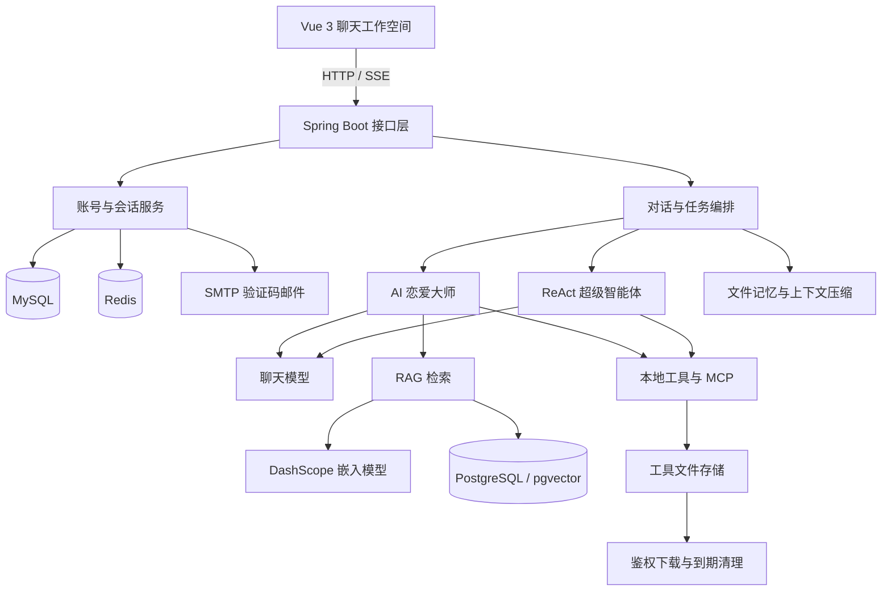

<div align="center">
  
  <h1>绘灵 AI · 智能体工作空间</h1>
  <p>让想法有人回应，让行动多一个帮手。</p>
  <p>Java 21 · Spring Boot · Spring AI · Vue 3 · RAG · MCP</p>
</div>

## 项目介绍

绘灵 AI 是一个前后端分离的 AI 应用项目，包含「AI 恋爱大师」与「AI 超级智能体」两个助手。

项目围绕完整的任务执行过程构建：从多轮交流、知识检索和工具调用，到用户补充信息、任务取消、结果展示及文件下载。用户可以在同一个工作空间中管理对话、查看执行进展，并在离开聊天页面后继续等待后台任务完成。


## 功能特性

### AI 恋爱大师

- **多轮情感交流**：围绕关系状态、沟通和相处问题展开对话，恢复同一会话的历史上下文。
- **RAG 知识检索**：检索单身、恋爱、已婚等主题的 Markdown 资料，为回答补充相关参考。
- **约会与行程规划**：结合用户提供的城市、预算及偏好，调用高德 MCP 查询地点、周边与路线。
- **方案与 PDF 输出**：调用文件和 PDF 工具整理结果，支持下载生成的报告。

### AI 超级智能体

- **ReAct 执行循环**：通过 `think()` 与 `act()` 选择工具、处理结果并继续执行，默认最多 20 步。
- **工具协同**：支持网页搜索、网页读取、图片搜索、文件操作、资源下载、终端操作及 PDF 生成。
- **真实人机交互**：缺少关键信息时调用 `AskHumanTool`，等待用户回答后继续当前任务。
- **执行与结果分开展示**：通过 SSE 推送执行进展、追问与最终答案，最终回复可展示图片并提供文件下载。
- **任务取消**：用户可以显式停止当前会话的任务，后端同步处理执行线程与等待中的追问。

### 会话与上下文管理

- 按**用户、应用和会话**隔离模型记忆，支持历史上下文恢复。
- 完整页面记录使用 JSON 保存，模型记忆使用 Kryo 文件持久化。
- 基于 Token 预算触发历史摘要压缩，尽量保留最近 4 轮原文及完整的工具调用关系。
- 支持查看上下文占用估算、手动压缩、压缩状态反馈与失败后保留原记忆。
- 支持会话重命名、逻辑删除，以及对应聊天记录、模型记忆和压缩备份的清理。
- 切换页面、切换会话或浏览器断开连接时，服务端任务可以继续执行；重新进入会话后读取已保存的进度。

### 文件与账号能力

- **文件下载**：生成的图片、PDF 和文本文件通过登录鉴权接口下载，不直接公开服务器文件目录。
- **文件隔离**：工具输出按用户与任务划分目录，完整写入后才发布下载链接。
- **到期清理**：工具文件默认保留 24 小时，启动时及之后每 5 分钟扫描一次；聊天记录不参与该清理。
- **邮箱账号**：支持验证码注册、密码登录、验证码登录、修改昵称、修改密码和找回密码。
- **登录态管理**：使用 Spring Session Redis 保存登录状态，配合 BCrypt、CSRF 校验和账号切换检查。
- **品牌邮件**：验证码邮件使用「绘灵 AI」发件人名称及正文内嵌 logo，提供 HTML 与纯文本正文。
- **本机历史缓存**：按账号缓存已加载的对话；生产构建支持在满足 Service Worker 条件时离线阅读缓存历史。

## 技术栈

| 层次 | 技术 |
| --- | --- |
| 后端基础 | Java 21、Spring Boot 3.4.4、Spring MVC、Java 虚拟线程 |
| AI 接入 | Spring AI、Spring AI Alibaba、OpenAI 兼容接口、DashScope |
| 智能体 | ReAct、Tool Calling、MCP、AskHuman |
| 知识检索 | MarkdownDocumentReader、关键词补充、DashScope Embedding、pgvector |
| 数据与会话 | MySQL、MyBatis-Plus、PostgreSQL、Redis、Spring Session |
| 流式通信 | SSE、SseEmitter、Reactor Flux、ReadableStream |
| 工具与文件 | Hutool、Jsoup、Kryo、iText、CommonMark |
| 前端 | Vue 3、Vite 6、Vue Router、Axios、Markdown-it、DOMPurify、Lucide |
| 接口与部署 | Knife4j / OpenAPI、Maven、Nginx |

> MySQL 用于账号与会话索引；PostgreSQL 用于向量知识库。完整聊天内容与工具产物存储在文件系统中。

## 架构概览



### 智能体任务链路

```text
用户输入 → 恢复会话上下文 → 模型选择工具 → 执行并记录结果
                         ↑                     │
                         └──── 继续下一步 ──────┘

缺少信息：发起追问 → 等待真实回答 → 继续同一任务
完成任务：整理最终答案 → 保存页面记录与模型记忆 → 展示结果和下载链接
```

## 工具能力

| 能力 | 实现方式 |
| --- | --- |
| 网页搜索 | 抓取公开搜索结果，支持分页、链接去重及部分结果反馈，可请求最多 50 条 |
| 网页读取 | 提取网页正文及图片、音视频链接，过滤脚本与样式 |
| 图片搜索 | 图片 MCP 与主应用增强工具协作，支持数量、尺寸标注及备用检索 |
| 文件操作 | UTF-8 读写、按行查看、精确文本替换 |
| 资源下载 | 将资源保存到当前用户的任务目录，返回真实下载链接 |
| PDF 生成 | 将 Markdown、表格与已下载图片转换为 PDF，使用随应用打包的中文字体 |
| 终端操作 | 查询宿主环境、执行命令、限制等待时间与保留输出，并处理超时进程 |
| 地图查询 | 通过高德 MCP 查询地点、周边、地址、天气及路线 |
| 用户追问 | 通过任务 ID 与问题 ID 关联提问和回答，校验归属、重复提交及超时 |

搜索结果数量、图片分辨率和网页内容取决于上游实际返回，不保证每次达到请求数量；缩略图不会被当作已核实的 4K 原图。

## 目录结构

```text
.
├── src/main/java/com/xiaoli/aiagent/
│   ├── agent/                 # ReAct 智能体及执行循环
│   ├── app/                   # 恋爱助手与提示词
│   ├── advisor/               # 日志、记忆与调用增强
│   ├── chatmemory/            # 文件记忆、Token 估算与摘要
│   ├── config/                # 数据源、账号、存储等配置
│   ├── controller/            # HTTP 与 SSE 入口
│   ├── conversation/          # 会话记录器与页面历史存储
│   ├── domain/                # 实体、请求和响应对象
│   ├── interaction/           # 人类提问与回答通道
│   ├── manager/               # 邮箱验证码管理
│   ├── mapper/                # MyBatis-Plus 数据访问
│   ├── rag/                   # 文档加载、关键词与向量检索
│   ├── service/               # 业务契约与实现
│   └── tools/                 # 本地工具及工具注册
├── src/main/resources/
│   ├── document/              # 恋爱知识库 Markdown 资料
│   ├── fonts/                 # 随应用打包的中文字体
│   ├── mail/                  # 验证码邮件模板和 logo
│   ├── sql/                   # MySQL 初始化脚本
│   └── application.yml        # 公共配置
├── ai-agent-frontend/         # Vue 前端，独立安装依赖和构建
└── image-search-mcp-server/   # 图片搜索 MCP，独立构建与运行
```

## 本地运行

### 1. 环境准备

准备 JDK 21、Maven、Node.js 20+、MySQL 8.0+、Redis，以及已安装 pgvector 的 PostgreSQL。主应用还需要可用的聊天模型、DashScope 嵌入模型、SMTP 邮件服务和已配置的 MCP 服务。

### 2. 初始化数据库

执行 MySQL 脚本，创建 `ai_agent` 数据库及账号、会话表：

```bash
mysql --default-character-set=utf8mb4 -u root -p < src/main/resources/sql/create_ai_agent.sql
```

PostgreSQL 需要提前创建数据库和连接用户，并安装所需扩展。在目标数据库中由有权限的账号启用：

```sql
CREATE EXTENSION IF NOT EXISTS vector;
CREATE EXTENSION IF NOT EXISTS hstore;
CREATE EXTENSION IF NOT EXISTS "uuid-ossp";
```

如果提示扩展不可用，需要先在 PostgreSQL 服务端安装对应扩展文件。应用会初始化 `public.vector_store` 表与索引；连接用户需要相应的建表和建索引权限。

### 3. 配置本地环境

新建 `src/main/resources/application-local.yml`。以下示例通过环境变量读取凭据，请先设置自己的连接信息与密钥：

```yaml
spring:
  datasource:
    driver-class-name: com.mysql.cj.jdbc.Driver
    url: ${MYSQL_URL:jdbc:mysql://127.0.0.1:3306/ai_agent?useSSL=false&serverTimezone=UTC&characterEncoding=UTF-8}
    username: ${MYSQL_USERNAME:root}
    password: ${MYSQL_PASSWORD:}
  data:
    redis:
      host: ${REDIS_HOST:127.0.0.1}
      port: ${REDIS_PORT:6379}
      database: 2
      password: ${REDIS_PASSWORD:}
  mail:
    host: ${MAIL_HOST:smtp.qq.com}
    port: ${MAIL_PORT:465}
    username: ${MAIL_USERNAME}
    password: ${MAIL_PASSWORD}
    protocol: smtps
    properties:
      mail:
        smtps:
          auth: true
          ssl:
            enable: true
  ai:
    openai:
      api-key: ${OPENAI_API_KEY}
      base-url: ${OPENAI_BASE_URL}
      chat:
        options:
          model: ${OPENAI_MODEL}
    dashscope:
      api-key: ${DASHSCOPE_API_KEY}
      chat:
        options:
          model: ${DASHSCOPE_CHAT_MODEL}
    chat:
      client:
        enabled: false
    mcp:
      client:
        sse:
          connections:
            server1:
              url: ${IMAGE_MCP_URL:http://127.0.0.1:8127}

app:
  vector-store:
    enabled: true
    initialize-data: false
  vector-datasource:
    driver-class-name: org.postgresql.Driver
    url: ${PGVECTOR_URL:jdbc:postgresql://127.0.0.1:5432/aiagent}
    username: ${PGVECTOR_USERNAME}
    password: ${PGVECTOR_PASSWORD}
```

其中，`OPENAI_API_KEY`、`OPENAI_BASE_URL`、`OPENAI_MODEL` 对应当前聊天模型；`DASHSCOPE_API_KEY`、`DASHSCOPE_CHAT_MODEL` 用于 DashScope 调用。`MAIL_PASSWORD` 填写邮件服务要求的 SMTP 密码或授权码。

公共配置中的高德 MCP 通过 `AMAP_MAPS_API_KEY` 读取密钥。按实际部署地址调整 MCP 连接；不使用的连接应从配置中移除，避免启动时尝试连接不可用服务。仅修改当前未加载的 `mcp-servers.json` 不会改变实际连接。

`application-local.yml` 与 `application-prod.yml` 已配置 Git 忽略，不需要将个人连接信息写入公共配置。

### 4. 启动图片搜索 MCP

该子项目独立构建。通过 SSE 为主应用提供服务时，显式指定 `sse` Profile：

```bash
mvn -f image-search-mcp-server/pom.xml clean package -DskipTests
java -jar image-search-mcp-server/target/image-search-mcp-server-0.0.1-SNAPSHOT.jar --spring.profiles.active=sse --pixabay.api-key=YOUR_PIXABAY_API_KEY
```

默认端口为 `8127`。将示例密钥替换为自己的 Pixabay API Key，并确保主应用的 MCP 地址指向该服务。

### 5. 启动主应用

在项目根目录执行：

```bash
mvn clean package -DskipTests
java -jar target/ai-agent-0.0.1-SNAPSHOT.jar --spring.profiles.active=local
```

公共配置当前默认激活 `prod`，本地启动时需要像上面这样显式选择 `local`。

- 后端地址：`http://localhost:8124/api`
- 健康检查：`http://localhost:8124/api/health`
- 接口文档：`http://localhost:8124/api/doc.html`

### 6. 启动前端

```bash
cd ai-agent-frontend
npm ci
npm run dev
```

访问 `http://localhost:5173`。开发环境通过 Vite 将 `/api` 转发到后端 `8124`，浏览器继续使用同域请求和 Cookie 登录。

前端环境文件：

| 文件 | 用途 |
| --- | --- |
| `.env.development` | 开发环境配置 |
| `.env.production` | 生产构建配置 |
| `.env.development.local` | 本机开发覆盖配置 |
| `.env.production.local` | 本机生产构建覆盖配置 |

## 模型与知识库配置

当前两个助手的主对话都使用 `openAiChatModel`；知识库关键词生成使用 `dashScopeChatModel`，向量生成使用 `dashscopeEmbeddingModel`。

默认嵌入配置为 `text-embedding-v4`、`1024` 维，与代码中的 pgvector 列维度保持一致。更换嵌入模型后，已有向量应使用新模型重新生成，不能仅凭维度相同继续混用。

### 首次导入知识库

资料位于 `src/main/resources/document/`。需要导入时，在启动参数中开启：

```text
--app.vector-store.initialize-data=true
```

应用会在向量表初始化后，加载 Markdown 片段、补充关键词、分批生成向量并写入 PostgreSQL。导入完成后恢复为 `false`，避免后续启动重复导入。

该开关只控制启动时的数据导入。关闭导入后，RAG 检索仍需要嵌入模型为用户查询生成向量。

### 在启动时切换聊天模型

使用兼容当前 Chat Completions 协议与工具调用方式的服务，覆盖以下参数即可，重启后生效：

```text
--spring.ai.openai.api-key=YOUR_API_KEY
--spring.ai.openai.base-url=https://your-model-provider.example
--spring.ai.openai.chat.options.model=YOUR_MODEL_NAME
```

这些是放在 JAR 文件名后面的应用参数。聊天模型与嵌入模型独立配置；当前未提供前端逐轮切换模型的功能。

## 生产部署

### 后端

准备生产环境配置，可保存为外部文件 `config/application-prod.yml`。在应用运行目录启动：

```bash
java -jar ai-agent-0.0.1-SNAPSHOT.jar --spring.profiles.active=prod --spring.config.additional-location=optional:file:./config/ --app.storage.base-dir=./data
```

`./data` 相对于进程工作目录解析，运行用户需要对该目录有读写权限。中文 PDF 字体与邮件 logo 从 classpath 读取，随 JAR 部署。

### 前端与 Nginx

```bash
cd ai-agent-frontend
npm ci
npm run build
```

将 `dist` **目录内的内容**部署到站点根目录，使用 Nginx 提供静态文件，并将同域 `/api/` 转发到后端：

```nginx
location / {
    try_files $uri $uri/ /index.html;
}

location ^~ /api/ {
    proxy_pass http://127.0.0.1:8124;
    proxy_http_version 1.1;
    proxy_set_header Host $host;
    proxy_set_header X-Real-IP $remote_addr;
    proxy_set_header X-Forwarded-For $proxy_add_x_forwarded_for;
    proxy_set_header X-Forwarded-Proto $scheme;
    proxy_set_header Connection "";
    proxy_buffering off;
    proxy_cache off;
    proxy_read_timeout 1800s;
}
```

`proxy_pass` 此处没有末尾的 `/`，会保留后端需要的 `/api` 路径前缀。SSE 需要关闭代理缓冲，并为长任务设置适当的读取超时。

HTTPS 部署可通过 `SESSION_COOKIE_SECURE=true` 启用 Secure Cookie。Service Worker 的离线页面能力需要 HTTPS 或浏览器认可的本机安全上下文。

## 文件保留规则

默认配置：

```yaml
app:
  storage:
    base-dir: ${APP_STORAGE_BASE_DIR:./tmp}
    file-retention: PT24H
    cleanup-interval: PT5M
```

文件完整写入时记录修改时间，以该时间作为有效期起点；下载不会延长有效期。文件到期后下载接口即拒绝访问，定时扫描再回收磁盘空间。因此，「保留 24 小时」是文件年龄限制，扫描间隔默认是 5 分钟。

仅清理 `download`、`pdf`、`file` 工具目录，不清理聊天记忆；聊天记录通过会话删除流程单独管理。

## 主要接口

以下路径均包含公共前缀 `/api`：

| 方法 | 路径 | 功能 |
| --- | --- | --- |
| GET | `/api/health` | 健康检查 |
| GET | `/api/auth/session` | 当前账号与 CSRF 标识 |
| POST | `/api/auth/email-code` | 发送注册、登录或找回密码验证码 |
| POST | `/api/auth/register` | 注册并登录 |
| POST | `/api/auth/login` | 密码登录 |
| POST | `/api/auth/code-login` | 验证码登录 |
| POST | `/api/ai/love_app/chat/sse` | 恋爱助手流式对话 |
| POST | `/api/ai/manus/chat` | 启动智能体任务 |
| POST | `/api/ai/manus/answer` | 提交追问答案 |
| GET | `/api/chats` | 当前账号的会话列表 |
| GET | `/api/chats/{id}` | 会话记录与运行状态 |
| PUT | `/api/chats/{id}/title` | 修改会话标题 |
| DELETE | `/api/chats/{id}` | 删除会话 |
| POST | `/api/chats/{id}/cancel` | 取消会话任务 |
| GET | `/api/chats/{id}/context` | 查看上下文占用估算 |
| POST | `/api/chats/{id}/context/compact` | 请求上下文压缩 |
| GET | `/api/files/{category}/{runId}?name=...` | 下载当前登录用户的有效文件 |

两个聊天接口通过 POST JSON 发送输入，前后端统一限制为 **20000 字符**。完整请求参数可查看接口文档与 Controller 定义。

## 测试

前端测试覆盖 SSE 解析、会话状态、接口调用、工具结果展示、图片预览及文件下载：

```bash
cd ai-agent-frontend
npm test
```

后端可按测试类选择执行，例如验证邮件内容、向量初始化顺序、分批嵌入、关键词模型选择和数据源隔离：

```bash
mvn -Dtest=EmailCodeManagerTest,VectorDataInitializationTest,PgVectorEmbeddingBatchTest,MyKeywordEnricherTest,DatabaseSplitTest test
```

部分集成测试依赖真实 Redis、数据库或模型服务，应配置好对应依赖后按需执行。

## 当前运行边界

- 正在执行的任务与等待中的追问保存在后端进程内；历史记录能够持久化，但后端重启后不会自动续跑未完成任务。
- 默认使用本地文件系统保存记忆和产物；多实例部署需要进一步设计共享存储、任务路由与运行状态管理。
- Token 占用是应用侧估算，工作预算需要与实际接入模型和网关的限制匹配。
- 终端工具按宿主进程权限执行命令，当前未提供容器级沙箱隔离。
- 邮件正文 logo 与收件箱头像属于不同展示位置；收件平台决定头像显示，真实发件邮箱仍可在邮件详情中查看。
